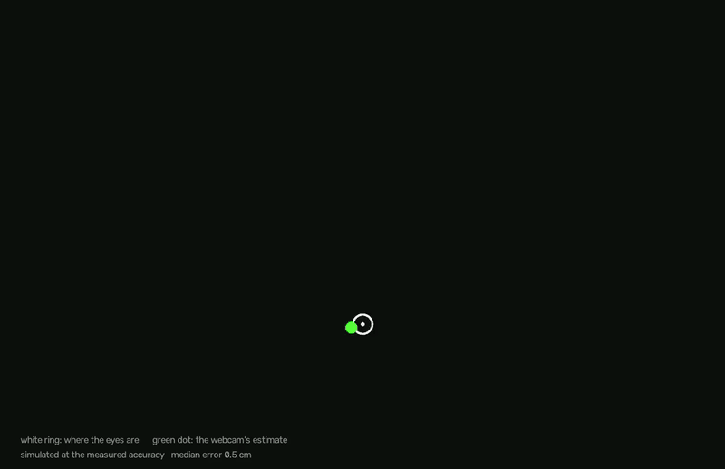

# Gaze with AirPods

Look at an agent's pane, press the button on your headset, talk. The words go to the agent you were looking
at. No mouse, no keyboard, no window switching.

A fork of [bhaktatejas922/gaze](https://github.com/bhaktatejas922/gaze) (MIT) with two changes:

- **Ghostty** instead of iTerm: the dot on the pane you look at, and the new-pane split, work in Ghostty 1.3+
  (iTerm panes are still recognised by the dot).
- **A headset button** instead of the DJI Mic Mini: an AirPods stem, or any Bluetooth headset's play/pause
  button (`--button-source media`), and a USB receiver's button by vendor and usage (`--button-vendor`,
  `--button-usage`). The DJI receiver still works as before.

Two parts:

- **gaze** (this directory): webcam eye tracking for the Mac. Where on your screens you are looking, from
  the built-in camera, on the laptop display and one external monitor, run on the Neural Engine. Expect
  one to two centimetres of error: enough to pick a pane or a window, not a word.
- **[micbtn](micbtn/)**: turns the button into dictation. One press asks gaze where you are looking, clicks
  there and starts hands-free dictation; the next press ends it and presses Enter once the text has landed.

## Install

Apple silicon, macOS 15 or later, [uv](https://docs.astral.sh/uv/), Xcode command line tools, Ghostty 1.3+,
and a dictation app with a hands-free shortcut on Fn+Space (Wispr Flow: `--dictation-app com.electron.wispr-flow`;
Granola is the default).

```bash
./install.sh                 # gaze: python environment, Core ML models (~3 GB download, a few minutes, once)
gaze                         # calibrate, then a live gaze dot on every screen
./micbtn/install.sh --no-analog --button-source media --dictation-app com.electron.wispr-flow \
  --triple-click "$PWD/micbtn/claude-split.sh claude-opus-5-5"     # AirPods stem
./install.sh --daemon --glow # gaze at login, run by MicBtn; the dot on the Ghostty pane you look at
```

Allow Accessibility, Input Monitoring and Camera for MicBtn as the installers ask. Then look at a pane and
squeeze the stem. Three squeezes open a new pane with Claude Code in it (`claude-split.sh`); drop
`--triple-click` for dictation only. `micbtn --gaze` prints where gaze thinks you are looking. Without the
gaze daemon, micbtn dictates into whatever has focus, as a plain button.

## Which button

| Headset | How its button reaches the Mac | Flags | State |
|---|---|---|---|
| AirPods (stem), any Bluetooth headset's play/pause | a play/pause command (AVRCP), which macOS gives to the Now Playing app; MicBtn claims to be it | `--button-source media` | confirmed on AirPods Pro (macOS 27): each squeeze arrives as one `pause` command |
| SteelSeries Arctis Nova 7, over its USB-C dongle | unknown until probed: a HID report from the dongle (vendor 0x1038), or nothing | `--button-vendor 1038 --button-usage PAGE:USAGE` | needs the probe below |
| SteelSeries Arctis Nova 7, over Bluetooth | its Bluetooth button is play/pause | `--button-source media` | same as AirPods |
| DJI Mic Mini | Volume Up from the receiver | none | upstream's, unchanged |

`--button-source media` costs what a music player costs: the keyboard's play/pause key goes to MicBtn too,
and while another app is really playing, the button is that app's. The headset also has to be on this Mac:
AirPods that have switched to a nearby iPhone send their presses there (`--media-silence` keeps a silent
stream running to hold them here).

**Calls.** While another app has a microphone open (FaceTime, Zoom, a browser call), the button stands down
and the eye tracker lets go of the camera; both come back when the mic closes. `micbtn --mics` says what it
sees; `--call-ignore <bundle id prefix>` exempts an app, `--no-call-pause` turns it off.

**One squeeze.** `--auto-send 1.5` ends dictation and sends once you have been quiet for 1.5 s, so a single
squeeze does the whole round. A second squeeze still ends it at once.

**Staying up.** The login jobs run `micbtn --supervise`, which restarts micbtn and the gaze daemon itself:
a macOS 27 login session can get stuck in launchd's "on-demand-only mode", where KeepAlive never fires.

**Finding a button.** `micbtn/probe/probe.sh media 40` becomes the Now Playing app and logs every command,
media key, HID value and SteelSeries report for 40 seconds: press each button a few times and read what
came out. `probe.sh mic 40` does the same with the microphone open, for buttons that only mean something
then (the AirPods mute gesture, a mute button that zeroes the audio).

## Accuracy



The white ring is where the eyes are; the green dot is the webcam's estimate. This clip is a simulation
drawn at the accuracy measured on my desk (1.2 cm median with the head moving), not a screen recording;
`gaze --demo 14 --record clip.mov` records the real thing on your own Mac. ([mp4](demo.mp4))

## Calibrate

About a minute per screen, once per person and per desk.

1. Laptop screen: look at each of 9 dots until it moves, head still.
2. Then 3 dots where you keep staring at the dot while you lean in, lean back and slide left and right.
   This is what makes it hold up when your head moves.
3. With an external monitor: the same on it, 9 dots and 2 moving ones. This solves where the monitor sits
   in space.

Afterwards a green circle follows your eyes. Stare at the grey crosses to judge it. `Esc` quits, `C`
recalibrates everything, `U` only the external monitor, `F` toggles smoothing. Recalibrate when the laptop
or the monitor moves.

## Commands

| Command | What it does |
|---|---|
| `gaze` | the live gaze dot (calibrates first when there is no calibration) |
| `gaze --recalibrate` | calibrate again from scratch |
| `gaze --serve` | no window: answer "where are they looking?" on a local socket, looking only when asked |
| `gaze --serve --track` | follow the eyes 20 times a second, so an answer is instant |
| `gaze --serve --glow` | `--track`, plus a small dot in the corner of the Ghostty pane being looked at |
| `gaze --point` | ask the running daemon once and print its answer |
| `gaze --demo 14 --record clip.mov` | the clip above: a target to follow, the gaze dot chasing it |
| `gaze --units gpu` | run the models on the GPU instead of the Neural Engine |

## The daemon

`gaze --serve` listens on `~/Library/Application Support/gaze/gaze.sock`. Send it anything and it answers
with one line: `x y laptop|external` in global screen points (the coordinates a mouse event takes), or
`none no-face` / `none off-screen`.

```bash
gaze --serve --track &
echo | nc -U ~/Library/Application\ Support/gaze/gaze.sock     # 812 440 laptop
```

It keeps the camera open (the green light stays on) and uses about 500 MB. It backs off to one look a
second when nobody is in front of the camera, stops while the display sleeps, and picks up a recalibration
or a monitor being plugged in without a restart.

`./install.sh --daemon` runs it at login through MicBtn (`micbtn --gaze-serve`), because macOS gives the
camera to an app and refuses a bare python under launchd. Started by hand from a terminal it uses the
terminal's Camera permission instead. `--glow` reads where Ghostty's panes are through Accessibility, which
MicBtn (or the terminal) needs.

## How it works

1. [MediaPipe](https://ai.google.dev/edge/mediapipe/solutions/vision/face_landmarker) finds the face and
   the head's pose in each camera frame.
2. The face is warped to the ETH-XGaze normalized view and run through
   [UniGaze](https://github.com/ut-vision/UniGaze) (ViT-H/14 and ViT-L/16, each on the face and on its
   mirror image, averaged), which gives a 3D gaze direction.
3. The gaze ray from the face is intersected with each screen. The laptop screen is the camera's own plane.
   The external monitor's position and tilt are solved from its calibration dots and the physical size
   macOS reports for it.
4. Calibration fits eight physical numbers per person (eye-axis offset, angle gain, depth scale, camera
   offset) and six per external monitor, not a black-box regression from landmarks to pixels. That is
   why it survives you moving: distance is part of the geometry instead of a guess.

## On the Neural Engine

`convert.py` turns the two UniGaze models into Core ML with fp16 activations and int8 per-channel weights.
Every operation of both lands on the Neural Engine. Measured on an M5 Pro, one face per call:

| | ViT-H/14 | ViT-L/16 |
|---|---|---|
| Neural Engine | 55 ms, 0.15 J | 17 ms, 0.04 J |
| GPU, idle | 17 ms | 12 ms |
| GPU, shared with other work | 40 to 75 ms | about 30 ms |
| file | 600 MB | 290 MB |

- **Why the Neural Engine when the GPU is faster.** Only an idle GPU is faster. A tracker that runs all day
  shares the GPU with everything else, and then it is slower and less steady than the Neural Engine, which
  nothing else uses. Energy per inference is the same order on both.
- **int8 weights** halve the files, run 15% faster on the Neural Engine than fp16 weights, and move the
  output by under 0.04 degrees.
- **A fraction of the work per frame.** The answer is the mean of four passes (two models, face and mirror
  image). A cheaper subset differs from that mean by a slowly changing offset, so each frame runs only the
  subset and adds the offset, and the rest run on one face every few seconds, one pass a frame, to keep
  the offset current. Calibration and the live view run both straight passes (about 80 ms a frame; against
  all four on live frames: no bias, 0.12 degrees of scatter). The tracking daemon runs ViT-L alone (about
  35 ms a frame, 0.5 degrees of scatter, which the median over a fixation takes back out).
- **Same answers as PyTorch.** All four passes through Core ML against the PyTorch ensemble on the same
  live frames: 0.04 degrees of scatter, 0.10 worst.
- **What did not help.** A batch of two is slower than two calls on the Neural Engine (154 ms against
  2 x 55). The fused attention op (`scaled_dot_product_attention`) is no faster than the plain one.

## Limits

- One person, one desk: calibration is per person and per screen layout.
- The built-in camera and at most one external monitor.
- Tested on one machine (M5 Pro, macOS 26). Glasses, low light and a face far off to the side all cost
  accuracy.
- `--glow` knows Ghostty and iTerm2 only.
- The headset buttons are new and only partly tested: see "Which button".

## Licences

The code here, gaze and micbtn, is MIT. The UniGaze weights it downloads are
[non-commercial](https://github.com/ut-vision/UniGaze#license) (ModelGo MG-NC-RAI-2.0), and
`face_model.txt` comes from the UniGaze repo, so check those terms before building a product on this.
